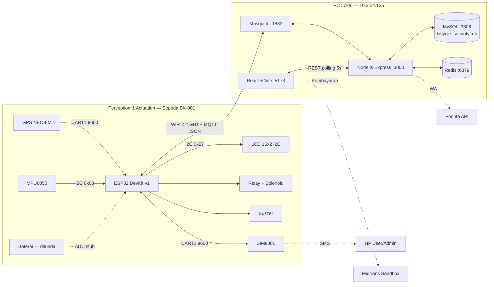

# Konteks Proyek — Integrasi Trabass IoT (Firmware + Backend + Frontend)

**Lokasi:** `d:\Code\ARDUINO\Praktikum IOT\Trabass-IoT-Firmware\konteks.md`
**Tanggal analisis:** 2026-11-16
**Lingkup:** PC lokal, bike tunggal `BK-001` (asumsi awal)

Dokumen ini berisi **fakta yang terverifikasi dari kode/konfigurasi/status service** serta asumsi, risiko, dan batasan yang harus diingat saat implementasi. Rencana kerja ada di `perencanaan.md`; peta folder ada di `struktur.md`.

---

## 1. Lingkungan lokal (terverifikasi 2026-11-16)

| Komponen | Nilai | Catatan |
|---|---|---|
| OS / host | Windows, firmware di `D:\` | PowerShell default |
| Node.js | `v22.15.0` | `npm` PowerShell kena execution policy; pakai `npm.cmd` bila perlu |
| Git | `2.47.0.windows.2` | Folder firmware **bukan** git repo |
| Arduino IDE / CLI | IDE terdeteksi (`.arduinoIDE` ada), `arduino-cli` tidak ada | Library diinstal via ekstraksi ZIP ke sketchbook |
| Paket board ESP32 | `3.3.12` | `AppData\Local\Arduino15\packages\esp32\hardware\esp32\3.3.12` |
| IP LAN PC | `10.3.24.125/22` (`Wi-Fi 2`) | ESP32 harus memakai IP ini, bukan `127.0.0.1` |
| IP lain | `192.168.56.1/24` (`Ethernet`) | Kemungkinan adapter virtual; hindari untuk device |
| Backend | `http://127.0.0.1:3000/health` | `status: success`, `redis_status: OK`, `mqtt_connected: true` |
| MySQL | `127.0.0.1:3306`, DB `bicycle_security_db` | Listen `0.0.0.0:3306` |
| Redis | `127.0.0.1:6379` | Listen `0.0.0.0:6379` |
| Mosquitto | `0.0.0.0:1883`, WebSocket `0.0.0.0:9001` | Service `mosquitto` Running, Automatic |
| Firewall inbound | Node.js dan mosquitto: Allow, Public | Diverifikasi |
| Reachability PC → IP sendiri | `10.3.24.125:1883` True, `:3000` True | Belum diuji dari ESP32 |
| Frontend dev server | Port `5173` tidak listen | Jalankan `npm run dev` saat uji UI |
| Sketchbook library | `C:\Users\ADVAN\OneDrive\Documents\Arduino\libraries` | Target instal library M1 |

### 1.1 Library Arduino — status M1

| Library | Versi target | Status | Lokasi |
|---|---|---|---|
| `TinyGPSPlus` (Mikal Hart) | `v1.0.3a` | Terinstal M1 | `...\Arduino\libraries\TinyGPSPlus` |
| `PubSubClient` (Nick O'Leary) | `v2.8` | Terinstal M1 | `...\Arduino\libraries\PubSubClient` |
| `ArduinoJson` (Benoit Blanchon) | `v7.4.3` | Terinstal M1 | `...\Arduino\libraries\ArduinoJson` |
| `LiquidCrystal_I2C` (Frank de Brabander) | existing | Sudah ada sebelum M1 | `...\Arduino\libraries\LiquidCrystal_I2C` |
| `Wire` (core ESP32) | bundled | Tersedia | paket board `esp32` |

> Driver USB-serial belum diverifikasi agent karena `arduino-cli` tidak tersedia. Pastikan port COM terlihat di Arduino IDE / Device Manager.

---

## 2. Arsitektur sistem (lokal)



**Prinsip data:**

- Jalur device↔backend: MQTT.
- Jalur UI↔backend: REST (polling 5 detik).
- Jalur SMS: SIM800L di device, dipicu `SEND_SMS`/tamper offline.
- Jalur WA: backend → Fonnte (bergantung token).
- Jalur pembayaran: frontend ↔ Midtrans Snap, diverifikasi backend.

---

## 3. Wiring & hardware baseline

### 3.1 Tabel pin (dari `sketch_nov16a.ino`, dikunci di `config.example.h`)

| Fungsi | Pin ESP32 | Arah/sinyal | Catatan |
|---|---|---:|---|
| I2C SDA | GPIO 21 | Bus I2C | Bersama LCD + MPU6050 |
| I2C SCL | GPIO 22 | Bus I2C | |
| GPS RX (ESP32 terima) | GPIO 16 | UART1 RX ← TX GPS | `gpsSerial.begin(9600, SERIAL_8N1, 16, 17)` |
| GPS TX (ESP32 kirim) | GPIO 17 | UART1 TX → RX GPS | |
| SIM800L RX | GPIO 26 | UART2 RX ← TXD SIM | `sim.begin(9600, SERIAL_8N1, 26, 27)` |
| SIM800L TX | GPIO 27 | UART2 TX → RXD SIM | Perhatikan level 2.8 V |
| Relay | GPIO 4 | Output digital | **Aktif LOW** |
| Buzzer | GPIO 19 | Output digital | Baseline toggle ~2 kHz |
| VCC/GND | 3V3/5V/GND | Daya | Sesuai kebutuhan tiap modul |
| Baterai (rencana) | GPIO 34 (ADC1) | Input analog | **DITUNDA**, `ENABLE_BATTERY_SENSOR 0` |

### 3.2 Alamat I2C

| Perangkat | Default | Alternatif |
|---|---:|---:|
| LCD 16x2 | `0x27` | `0x3F` |
| MPU6050 | `0x68` | `0x69` (AD0 HIGH) |

### 3.3 Perilaku relay & state

| Kondisi logis | `lock_state` | Relay pin | Solenoid |
|---|---|---|---|
| Terkunci | `true` | HIGH (`RELAY_OFF`) | Nonaktif/terkunci |
| Terbuka | `false` | LOW (`RELAY_ON`) | Aktif/terbuka |

> Jika polaritas modul ternyata terbalik, tukar `RELAY_ON`/`RELAY_OFF` di `config.h` **setelah uji T12/T13**, bukan menebak.

### 3.4 Rangkaian baterai (rencana, belum terpasang)

- Pembagi 100 kΩ / 100 kΩ + kapasitor 100 nF ke GPIO 34.
- Faktor ~2.0 → 4.2 V menjadi ~2.1 V, aman untuk ADC 3.3 V.
- Rumus awal: `Vbat = (adc/4095) * 3.3 * 2.0`, mapping 3.30 V = 0%, 4.20 V = 100%.
- Kalibrasi wajib dengan multimeter (T07) saat hardware tersedia.

### 3.5 Fungsi tes baseline (harus dipertahankan)

| Perintah | Fungsi | Catatan |
|---|---|---|
| `a` | Tes otomatis semua (kecuali relay) | Saat ini dipanggil di `setup()` — **harus dipindah ke self_test** |
| `1` | Tes LCD | Init `0x27` + backlight |
| `2` | Tes buzzer | 3× beep 200 ms |
| `3` | Toggle relay | Manual |
| `4` | Baca MPU6050 5× | Acc/Gyro/Suhu |
| `5` | Status GPS 5 detik | Fix + satelit |
| `6` | Tes SIM800L | AT, CPIN, CSQ, CREG, CBC |
| `7` | Kirim SMS tes | Perlu nomor aktif |
| `s` | Scan I2C | Cek `0x27`/`0x68` |
| `h` | Bantuan | Daftar perintah |
| `AT...` | Forward ke SIM800L | Balasan ke Serial |

---

## 4. Backend — fakta integrasi

### 4.1 Lokasi & stack

- Repo: `d:\Code\Javascript\Trabass-IoT-Backend`
- Runtime: Node.js, Express 5, CommonJS
- Dependensi inti: `mysql2`, `redis`, `mqtt`, `jsonwebtoken`, `midtrans-client`, `haversine-distance`, `axios`
- Entry: `src/app.js` (`/api`, `/health`)
- MQTT: `src/config/mqtt.js`, subscribe `bike/telemetry/+`
- Env: `MQTT_BROKER_URL=mqtt://127.0.0.1:1883`, `DB_NAME=bicycle_security_db`

### 4.2 Kontrak MQTT existing

**Telemetry uplink:** `bike/telemetry/{bike_id}`

```json
{
  "lat": -7.773512,
  "lng": 110.385411,
  "speed": 0.0,
  "mpu_motion": false,
  "lock_state": true,
  "battery": 87
}
```

| Field | Tipe | Wajib existing | Arti |
|---|---|---|---|
| `lat` | number/null | Ya untuk path existing | Latitude |
| `lng` | number/null | Ya untuk path existing | Longitude |
| `speed` | number | Tidak (default 0) | km/jam |
| `mpu_motion` | boolean-like | Tidak (default false) | Gerakan/getaran |
| `lock_state` | boolean-like | Tidak (default false) | `true` = terkunci |
| `battery` | number/null | Tidak | 0–100 persen |

Field tambahan aman: `gps_fix`, `satellites`, `uptime_ms`, `fw_version`, `alarm_active` — diabaikan backend.

**Command downlink:** `bike/command/{bike_id}`

| Action | Payload contoh | Pemicu utama |
|---|---|---|
| `UNLOCK` | `{"action":"UNLOCK"}` | Settlement, admin force unlock |
| `LOCK` | `{"action":"LOCK"}` | Selesai sewa, admin force lock |
| `ALARM_ON` | `{"action":"ALARM_ON"}` | Tamper/geofence |
| `ALARM_OFF` | `{"action":"ALARM_OFF"}` | Admin |
| `LOCK_AND_ALARM` | `{"action":"LOCK_AND_ALARM"}` | Sewa habis |
| `WARNING_BEEP` | `{"action":"WARNING_BEEP","message":"..."}` | Sisa ≤ 5 menit |
| `EXTEND_TIME` | `{"action":"EXTEND_TIME","duration":30}` | Perpanjangan |
| `SEND_SMS` | `{"action":"SEND_SMS","phone":"...","message":"..."}` | Fallback WA gagal |

### 4.3 Database (tabel relevan)

| Tabel | Kolom kunci | Catatan |
|---|---|---|
| `bikes` | `bike_id`, `status`, `lock_state`, `battery_percent`, `last_latitude`, `last_longitude` | State armada |
| `telemetry_logs` | `bike_id`, `latitude NOT NULL`, `longitude NOT NULL`, `speed`, `mpu_motion`, `lock_state`, `recorded_at` | Tanpa koordinat → jangan insert |
| `security_incidents` | `bike_id`, `rental_id`, `type`, `description`, `latitude`, `longitude`, `status` | lat/lng nullable |
| `admin_command_logs` | `bike_id`, `admin_user_id`, `action`, `status` | `SENT` = diterima broker |
| `app_settings` | `setting_key`, `setting_value` | Geofence, cooldown tamper, threshold baterai, tarif |

### 4.4 Temuan penting & aksi

| Temuan | Dampak | Aksi |
|---|---|---|
| Telemetri tanpa `lat/lng` dibuang | Baterai/IMU/lock hilang saat indoor | **Patch M3** di `telemetryController.js` |
| `timerService`/`paymentController` bisa `hSet` tanpa koordinat | `has_live_location` salah | Guard live hash parsial |
| `SENT` ≠ dieksekusi | Status palsu | Verifikasi lewat telemetri; ACK ditunda |
| `SEND_SMS` via MQTT bukan fallback sejati | Offline → SMS tidak jalan | Opsional SMS lokal saat tamper + offline |
| Broker anonymous tanpa TLS | Risiko LAN | Diterima lokal; produksi perlu auth+TLS |
| `telemetry_logs` cepat besar (±17k/hari @5s) | Storage | Evaluasi throttling setelah M7 |
| `ALARM_ON` tidak auto-OFF | Sirene terus | Auto-off 60 s + `ALARM_OFF` |

---

## 5. Frontend — fakta integrasi

- Repo: `d:\Code\Javascript\Trabass-IoT-Frontend`
- Stack: React 19, Vite 8, Tailwind 3, Leaflet, Axios, React Router 7
- API: `VITE_API_URL` = `http://localhost:3000/api`, polling 5 detik
- Komponen relevan: `BatteryGauge.jsx`, `ImuMonitorPanel.jsx`, `FleetMap.jsx`, `useAdminBikes.js`, `useAdminBikeDetail.js`, `useBikeCommands.js`, `fleetTelemetry.js`
- Threshold stale: 30 detik
- **Tidak ada perubahan frontend untuk baseline M1–M4.**

Jika PWA dibuka dari HP: set `VITE_API_URL` ke IP LAN PC dan jalankan Vite dengan `--host`.

---

## 6. Kontrak telemetri final (firmware → backend)

**Topic:** `bike/telemetry/BK-001` (QoS 1, retain false)

**Dengan fix:**

```json
{
  "lat": -7.773512,
  "lng": 110.385411,
  "speed": 1.2,
  "mpu_motion": false,
  "lock_state": true,
  "gps_fix": true,
  "satellites": 9,
  "uptime_ms": 123456,
  "fw_version": "1.0.0-m3"
}
```

**Tanpa fix:**

```json
{
  "lat": null,
  "lng": null,
  "speed": 0.0,
  "mpu_motion": false,
  "lock_state": true,
  "gps_fix": false,
  "satellites": 0,
  "uptime_ms": 123456,
  "fw_version": "1.0.0-m3"
}
```

| Field | Tipe | Sumber | Catatan |
|---|---|---|---|
| `lat`, `lng` | number/null | GPS | Null saat no-fix |
| `speed` | number | GPS | km/jam, default 0 |
| `mpu_motion` | boolean | classifier MPU6050 | Satu-satunya output IMU ke backend |
| `lock_state` | boolean | state relay | `true` = terkunci |
| `gps_fix` | boolean | GPS | Tambahan aman |
| `satellites` | integer | GPS | Diagnostik |
| `uptime_ms` | integer | `millis()` | Diagnostik |
| `fw_version` | string | config | Diagnostik |
| `battery` | — | ditunda | **Tidak dikirim** |

---

## 7. Kontrak command final (backend → firmware)

**Topic:** `bike/command/BK-001` (subscribe QoS 1)

| Action | Efek firmware | LCD | Buzzer | Catatan |
|---|---|---|---|---|
| `UNLOCK` | relay ON, `lock_state=false` | `TERBUKA` | Stop alarm | Idempotent |
| `LOCK` | relay OFF, `lock_state=true` | `TERKUNCI` | — | Idempotent |
| `ALARM_ON` | Mulai sirene | `ALARM` | ON | Auto-off 60 s |
| `ALARM_OFF` | Hentikan sirene | sesuai state | OFF | |
| `LOCK_AND_ALARM` | Lock + sirene | `ALARM` | ON | Timer habis |
| `WARNING_BEEP` | 3 beep | `PERINGATAN` | Beep | Non-blocking |
| `EXTEND_TIME` | Simpan deadline lokal | `PERPANJANG` | — | Opsional |
| `SEND_SMS` | Antre SMS ke SIM800L | — | — | Butuh nomor + pesan |

**Aturan eksekusi:**

- Parse aman; action tidak dikenal → log + abaikan.
- Callback MQTT tidak boleh `delay()` panjang.
- Setelah eksekusi, publish telemetri terbaru.
- Command duplikat QoS 1 tidak boleh efek ganda berbahaya.

---

## 8. Asumsi, batasan, dan hal terbuka

### 8.1 Asumsi aktif

| Asumsi | Status |
|---|---|
| Bike ID `BK-001` | Aktif |
| Relay aktif LOW, `LOCK` = relay OFF | Aktif |
| Alarm default 60 detik, configurable | Aktif |
| Reboot saat sewa → default terkunci | Aktif |
| Menu tes serial dipertahankan di balik flag | Aktif |
| GPS diuji outdoor untuk T05/T22 | Aktif |
| SIM800L punya SIM aktif + pulsa untuk T19 | **Belum dikonfirmasi** → T19 BLOCKED |
| Midtrans sandbox valid untuk T20 | **Belum diverifikasi** → substitusi admin unlock |
| DHCP reservation `10.3.24.125` | Disarankan, belum dikonfirmasi |

### 8.2 Batasan fase lokal (diketahui dan diterima)

- Baterai `N/A` (hardware ADC/divider belum ada).
- Tidak ada ACK perintah device→backend.
- Tidak ada timer lokal/NVS untuk auto-lock saat offline.
- Broker MQTT anonymous, tanpa TLS.
- Frontend/backend tidak diubah untuk baseline, kecuali patch no-fix di M3.
- Raw IMU tidak disimpan/dikirim.

### 8.3 Yang harus diisi user di `config.h`

- `WIFI_SSID`, `WIFI_PASSWORD` (2.4 GHz)
- `MQTT_BROKER_HOST` jika IP PC berubah
- `NOMOR_TUJUAN` untuk tes SMS manual

> **Jangan** mengirim kredensial di chat. Isi langsung di file lokal.

---

## 9. Referensi cepat lokasi kode

| Area | Path |
|---|---|
| Firmware root | `d:\Code\ARDUINO\Praktikum IOT\Trabass-IoT-Firmware` |
| Sketch aktif | `...\sketch_nov16a\sketch_nov16a.ino` |
| Baseline | `...\baseline\sketch_nov16a_baseline\` |
| Backend root | `d:\Code\Javascript\Trabass-IoT-Backend` |
| Telemetry controller | `...\src\controllers\telemetryController.js` |
| MQTT config backend | `...\src\config\mqtt.js` |
| Bike command service | `...\src\services\bikeCommandService.js` |
| Timer service | `...\src\services\timerService.js` |
| Schema DB | `...\schema.sql` |
| Mosquitto config | `...\mosquitto.conf` |
| Frontend root | `d:\Code\Javascript\Trabass-IoT-Frontend` |
| API client | `...\src\services\api.js` |
| Telemetry helpers | `...\src\utils\fleetTelemetry.js` |
| Battery UI | `...\src\components\admin\BatteryGauge.jsx` |
| IMU UI | `...\src\components\admin\ImuMonitorPanel.jsx` |
