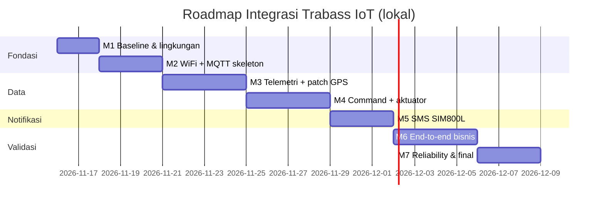
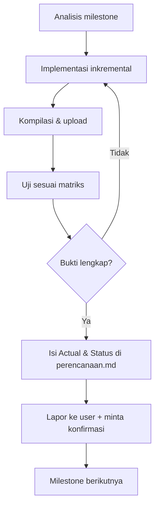

# Perencanaan Integrasi Firmware — Trabass IoT

**Lokasi dokumen:** `d:\Code\ARDUINO\Praktikum IOT\Trabass-IoT-Firmware\perencanaan.md`
**Versi:** 1.4 — **Tanggal:** 2026-11-19
**Status saat ini:** M1–M3 selesai; **M4 selesai (logika/state)**, menunggu konfirmasi manual buzzer/LCD sebelum dilanjut M5
**Bahasa:** teknis Indonesia (tingkat mahasiswa Informatika)

---

## 1. Tujuan dokumen

Dokumen ini menjadi **sumber tunggal rencana integrasi** firmware ESP32 dengan backend dan frontend yang sudah ada. Isinya:

1. Keputusan arsitektur yang sudah dikunci bersama user.
2. Rincian milestone **M1 sampai M7** beserta kriteria selesai.
3. Matriks test case dengan kolom **Actual** dan **Status** yang diisi hanya jika pengujian benar-benar dijalankan.
4. Aturan kerja inkremental: satu milestone selesai → user konfirmasi → milestone berikutnya.

Dokumen pendamping:

- `konteks.md` → fakta lapangan, wiring, kontrak data, temuan, batasan.
- `struktur.md` → struktur folder dan tanggung jawab tiap file.

---

## 2. Prinsip kerja (commit bersama user)

| No | Prinsip | Konsekuensi teknis |
|---|---|---|
| P1 | Jalankan di PC lokal dulu | MQTT ke `10.20.226.246:1883`, bukan cloud |
| P2 | Jangan merombak yang sudah jalan | Schema DB, endpoint, dan hardware test existing dipertahankan |
| P3 | Perubahan kecil dan terisolasi | Patch backend no-GPS-fix hanya di `telemetryController.js` |
| P4 | Inkremental per milestone | Tidak ada kode M3 sebelum M2 diterima user |
| P5 | Tidak klaim sukses tanpa bukti | Kolom Actual berisi log/output nyata; jika belum diuji → `NOT RUN` |
| P6 | Modular tapi tidak berlebihan | Pecah per komponen, bukan per fungsi kecil |
| P7 | Konfigurasi terpisah dari logika | Semua pin, IP, threshold, dan flag ada di `config.h`/`config.example.h` |
| P8 | Logging + error handling | Tiap modul mencetak prefix `[MODUL]`, gagal → log + state aman, tidak reset |
| P9 | Keamanan minimum | Kredensial tidak di chat, topic dibatasi per bike ID, SMS sanitasi ASCII |

---

## 3. Keputusan arsitektur final

| Topik | Keputusan | Alasan |
|---|---|---|
| Jaringan | ESP32 + PC satu router Wi-Fi 2.4 GHz | Backend dan broker sudah bind `0.0.0.0`, firewall diizinkan |
| Protokol device | MQTT over Wi-Fi | Backend sudah subscribe `bike/telemetry/+` dan publish command |
| Protokol UI | REST + polling 5 detik | Implementasi frontend sudah seperti ini; tidak perlu WebSocket |
| SIM800L | SMS saja | Tidak ada stack GPRS/MQTT; dipakai untuk notifikasi/fallback |
| GPS tanpa fix | Patch backend kecil | Baterai/IMU/lock tetap masuk dashboard saat demo indoor |
| Detail IMU | Boolean `mpu_motion` saja | Tidak perlu migration schema, tidak perlu grafik raw |
| Baterai | Ditunda (`N/A`) | Hardware divider/INA219 belum tersedia; modul dibuat stub |
| Reliability | Reconnect + publish state terakhir + stale 30 s | Sesuai scope lokal; ACK/retry/NVS ditunda |
| Struktur firmware | Modular per komponen | Memudahkan perawatan dan pengujian |
| Alarm default | 60 detik, configurable | Mencegah buzzer menyala terus |
| Reboot saat sewa | Default **terkunci** (fail-safe) | Menghindari sepeda terbuka tanpa sesi aktif |
| Relay | Aktif LOW; `LOCK` = relay OFF (pin HIGH) | Sesuai `RELAY_ON LOW` / `RELAY_OFF HIGH` di baseline |
| Bike ID | `BK-001` | Konvensi yang dipakai kontrak MQTT |

### 3.1 Diagram alur milestone

> Tanggal di diagram adalah **estimasi relatif**, bukan komitmen waktu. Tiap milestone menunggu konfirmasi user.

### 3.2 Alur kerja satu milestone

---

## 4. Rincian milestone

### M1 — Baseline, konfigurasi, dan verifikasi lingkungan

**Tujuan:** memastikan kode tes existing aman, library tersedia, jaringan lokal terjangkau, dan dokumentasi fondasi terbentuk. **Belum ada logika integrasi yang ditulis.**

**File yang dibuat/diubah:**

- `baseline/sketch_nov16a_baseline/sketch_nov16a_baseline.ino` + `README.md`
- `sketch_nov16a/config.example.h`
- `sketch_nov16a/config.h`
- `perencanaan.md`, `konteks.md`, `struktur.md`

**Langkah:**

1. Salin `sketch_nov16a.ino` ke folder baseline dan rekam SHA-256.
2. Instal library: TinyGPSPlus `v1.0.3a`, PubSubClient `v2.8`, ArduinoJson `v7.4.3`.
3. Verifikasi board ESP32 (paket `esp32` 3.3.12) dan library existing `LiquidCrystal_I2C`.
4. Verifikasi `GET /health` backend dan port yang listen.
5. Verifikasi IP LAN (M1: `10.3.24.125`, M2 hotspot: `10.20.226.246`) untuk port 1883 dan 3000.
6. Verifikasi firewall inbound Node.js dan mosquitto.
7. Tulis kontrak telemetri, wiring, dan checklist baseline ke `konteks.md`.
8. Tulis struktur folder ke `struktur.md`.

**Kriteria selesai M1:**

- [x] Backup baseline memiliki SHA-256 terekam
- [x] Ketiga library terinstal di sketchbook library
- [x] `/health` sukses, MySQL/Redis/MQTT OK
- [x] Port 1883/3000/3306/6379 listen dan firewall mengizinkan
- [x] `10.20.226.246:1883` dan `:3000` reachable dari PC (M1 sempat `10.3.24.125`)
- [x] `config.example.h` + `config.h` terbentuk
- [x] Tiga dokumen perencanaan/konteks/struktur terbentuk
- [x] User mengisi `WIFI_SSID`, `WIFI_PASSWORD`, `MQTT_BROKER_HOST` di `config.h` (diverifikasi M2: ESP32 connect)
- [x] User menjalankan menu tes baseline `a`, `1`–`7`, `s` (dilaporkan berhasil; agent memverifikasi ulang `1`–`6`, `s`, `h` pada M2)

**Status M1:** dokumentasi dan verifikasi lingkungan selesai; kredensial sudah diisi dan konektivitas terbukti pada M2 (WiFi + MQTT).

---

### M2 — Kerangka komunikasi firmware

**Tujuan:** ESP32 terhubung Wi-Fi dan MQTT, subscribe command, publish heartbeat, dan pulih otomatis.

**File:** `sketch_nov16a.ino`, `app_types.h`, `mqtt_link.h/.cpp`, `config.h`

**Langkah:**

1. Init serial, `Wire`, dan pin dengan state aman (relay OFF, buzzer LOW).
2. `wifiEnsureConnected()` non-blocking dengan timeout dan retry dari config.
3. `mqttEnsureConnected()` dengan client ID unik `trabass-BK-001`, subscribe `bike/command/BK-001`.
4. Heartbeat/status tiap 5 detik (boleh memakai payload telemetri minimum).
5. Reconnect backoff; setelah reconnect, publish state terakhir jika `MQTT_PUBLISH_ON_RECONNECT`.
6. Callback MQTT hanya menaruh command ke antrean, tidak mengubah GPIO langsung.

**Pengujian:** B02–B04, T02–T04, T25.

**Kriteria selesai:** reconnect < 15 detik, tidak ada watchdog reset, heartbeat terlihat di `mosquitto_sub`, menu tes serial masih bisa dipakai.

**Hasil M2 (2026-11-16):**

- Kompilasi `arduino-cli` exit 0; 936.060 byte flash (71%), RAM global 49.776 byte (15%). Tidak ada error/warning pada kode sketch (hanya peringatan deprecated library `LiquidCrystal_I2C`).
- Boot: `POWERON_RESET` → `[BOOT] Trabass fw=1.0.0-m2 bike=BK-001` → relay OFF / buzzer LOW.
- WiFi connect **1,09 dtk**, MQTT connect **1,88 dtk** (target < 15 dtk).
- Heartbeat tiap 5 dtk: `type=heartbeat`, `fw_version=1.0.0-m2`, RSSI -50…-60 dBm, `lock_state=true`.
- Command `bike/command/BK-001` diterima callback dan masuk antrean: `[MQTT] Command masuk 15 B`, `[CMD] Diterima`.
- Menu regresi: `n`, `m`, `h`, `s` OK; `1` LCD OK, `2` buzzer jalan, `3` relay ON→OFF (state akhir terkunci), `4` MPU OK, `5` GPS FIX 21 satelit, `6` SIM800L **tidak membalas**.
- Reconnect terbukti (2026-11-16): hotspot dimatikan ±30 dtk → `[WIFI] Koneksi terputus`, retry tiap 10 dtk, WiFi pulih ±1 dtk setelah hotspot tersedia, MQTT connect 5 dtk kemudian, heartbeat publish-on-connect muncul (jeda heartbeat 38,3 dtk). Command JSON valid diterima setelah reconnect → subscribe terpasang ulang.
- Catatan kosmetik: ESP-IDF mencetak `E wifi:sta is connecting, return error` saat `WiFi.reconnect()` dipanggil ketika stack masih connecting; koneksi tetap berhasil. Tidak mengubah perilaku.
- SIM800L **tidak membalas AT** (5 percobaan) → wiring/power perlu dicek sebelum M5; T19 tetap BLOCKED.

**Status M2:** selesai dan terverifikasi (T03 PASS, T04 PARTIAL karena restart service tidak dilakukan; jalur subscribe-on-connect terbukti). Menunggu konfirmasi user sebelum M3.

---

### M3 — Telemetri GPS, IMU, lock state, dan patch backend

**Tujuan:** data sensor masuk Redis/MySQL/dashboard, termasuk saat GPS belum fix.

**File:** `gps_sensor.h/.cpp`, `imu_sensor.h/.cpp`, `battery_sensor.h/.cpp` (stub), `telemetry.h/.cpp`, `outputs.h/.cpp`, `src/controllers/telemetryController.js`

**Langkah:**

1. GPS dibaca non-blocking lewat `gps.encode()` di tiap loop; simpan `lat`, `lng`, `speed`, `satellites`, `gps_fix`.
2. MPU6050 sample tiap 100 ms; klasifikasi `mpu_motion` dengan threshold + hold/idle dari config.
3. Modul baterai mengembalikan `false` karena `ENABLE_BATTERY_SENSOR 0`; field `battery` tidak dikirim.
4. Builder JSON menghasilkan payload kontrak (lihat `konteks.md` bagian 6).
5. Publish tiap `TELEMETRY_INTERVAL_MS`.
6. Patch backend: telemetri tanpa `lat/lng` tetap update Redis (lock/IMU/speed/`gps_fix=false`/`updated_at`), jalankan deteksi tamper, **skip** geofence dan insert `telemetry_logs`.

**Pengujian:** T05, T06, T08, T09, T10, T11, T23, T26 (T26 deferred).

**Kriteria selesai:** 10/10 payload valid; dashboard update ≤ 10 detik; tanpa fix tetap ada data IMU/lock; tidak ada error SQL `NOT NULL`.

**Status M3:** implementasi selesai dan diuji. Firmware produksi `1.0.0-m3` terpasang terakhir di COM14; backend lokal berjalan dengan `npm.cmd run dev` (nodemon). Telemetri fix, no-fix, Redis, MySQL, dan dashboard terbukti; dua uji memakai instrumentasi karena threshold gerak dan koordinat ruang uji tidak memungkinkan reproduksi kondisi normal.

**Bukti utama:**

- `m3_compile_final.log`: exit 0, 939.744 B (71%), RAM 49.824 B (15%).
- `m3_upload_final.log`: hash verified, COM14.
- `m3_final_mqtt.log`: payload fix 156–157 B, 18–22 satelit, interval ~5 dtk.
- `m3_nofix.log`: payload firmware `lat/lng:null`; `telemetry_logs` 116→116; koordinat `bikes` tidak berubah; Redis `HEXISTS lat/lng=0`; recovery `=1`.
- `m3_tamper.log`, `m3_unlocked.log`: TAMPER id 9 dan 10, alert `notified=true`.
- `m3_backend.log`/`m3_backend.err.log`: tidak ada `[TELEMETRY ERROR]` atau `NOT NULL`.
- Dashboard API: `has_live_location=true`, `lock_state=true`, `mpu_motion=false`, `battery_percent=null`.

**Keterbatasan yang dicatat:**

- T08/T23 memakai build override `-DIMU_MOTION_ACCEL_THRESHOLD_G=0.001f -DIMU_MOTION_GYRO_THRESHOLD_DPS=9999.0f`. Gerakan fisik dengan threshold produksi (0.35 g / 40 dps) belum diuji.
- T09 memakai payload synthetic `lock_state:false,mpu_motion:true` tanpa koordinat, bukan gerakan fisik.
- Resolusi TAMPER otomatis setelah 120 dtk **tidak berjalan selama geofence masih violated** karena `handleTelemetry` sudah `return` di blok alert. Insiden 10 ditutup lewat payload unlock (19:02:08). Ini perilaku backend lama, bukan regresi patch M3; perlu keputusan user bila ingin diperbaiki.
- GPS ruang uji `-7.78243,110.41583` berjarak ~3,49 km dari pangkalan lama `STATION_LAT=-7.773512`, `STATION_LNG=110.385411` (radius 500 m), sehingga semua telemetri fix memicu `GEOFENCE_VIOLATION`.
- **Keputusan M4:** pangkalan diubah ke Kampus 1 UPN Veteran Yogyakarta `STATION_LAT=-7.7626945`, `STATION_LNG=110.4095241` dan `GEOFENCE_RADIUS_M=5000`. Lokasi uji ~2,30 km dari titik baru → di dalam batas aman. Alert Redis `bike:BK-001:alert` otomatis `active=false` pada restart backend 08:08:09 dengan `resolved_status=OVERDUE`; tidak ada log `GEOFENCE_VIOLATION` baru setelahnya.
- Baterai `DEFERRED` (hardware belum ada); SMS T19 `BLOCKED` (SIM800L belum membalas `AT`).

---

### M4 — Command downlink dan aktuator

**Tujuan:** perintah backend benar-benar menggerakkan relay, buzzer, dan LCD.

**File:**

- Baru: `command_handler.h/.cpp`, `outputs.h/.cpp`
- Diubah: `mqtt_link.cpp` (antrean diserahkan ke handler), `sketch_nov16a.ino`, `self_test.cpp` (`toggleRelay()` delegate ke `outputs`), `telemetry.cpp` tidak diubah (pin relay tetap sumber `lock_state`), `config.example.h`, backend `.env` (geofence)

**Command yang didukung:** `UNLOCK`, `LOCK`, `ALARM_ON`, `ALARM_OFF`, `LOCK_AND_ALARM`, `WARNING_BEEP`, `EXTEND_TIME`, `SEND_SMS` (log `PENDING_M5`), unknown → log + abaikan.

**Langkah yang diterapkan:**

1. Parse JSON ArduinoJson v7; validasi `action`; baca opsional `timestamp`, `message`, `duration_ms`, `added_minutes`, `end_time`, `target_phone`.
2. Dedupe ringan 4 slot berdasarkan `action|timestamp` dalam `COMMAND_DEDUPE_WINDOW_MS` (default 3000 ms).
3. `outputs` menjadi pemilik tunggal relay/buzzer/LCD. Setter absolut (idempoten), alarm auto-off, beep 3 pulse non-blocking, pesan LCD otomatis revert.
4. Alarm tidak diperpanjang oleh `ALARM_ON` berulang selama masih aktif.
5. Setiap command yang dieksekusi segera memanggil `telemetry::publishNow()` (force publish QoS 0).
6. Menu tes serial `3` kini memanggil `outputs::setLock()` sehingga state tidak desinkron.

**Pengujian:** T12–T18, T24, T30 + regresi T01/T05/T10/T11 dan menu serial.

**Kriteria selesai:** respons < 2 detik; `ALARM_OFF` mematikan sirene; command ganda tidak merusak state.

**Actual ringkas (2026-11-19):**

- Build override `ALARM_DURATION_MS=3000` → upload COM14 sukses; build produksi 60 dtk → upload ulang COM14 sukses.
- `fw_version=1.0.0-m4`; flash 950.420 B (72%), RAM 50.328 B (15%).
- T12/T13: `UNLOCK` → relay ON/pin LOW/`lock_state:false`; `LOCK` → relay OFF/pin HIGH/`lock_state:true`; telemetri force publish langsung muncul.
- T14/T15/T16: `ALARM_ON` 3000 ms → auto-off; `ALARM_OFF` mematikan sebelum auto-off; `LOCK_AND_ALARM` menyisakan keadaan terkunci setelah alarm mati. Build produksi diverifikasi `ALARM ON selama 60000 ms`.
- T17/T18: `[LCD] Pesan ... 'PERINGATAN' | 'Ada gerakan menc'`, `3 pulse` beep; `PERPANJANG | Ditambah 15 mnt`, `added_minutes=15 end_time=...` terbaca.
- T24: dua `LOCK` identik berturut-turut → yang kedua `[CMD] Duplikat dalam 3000 ms, diabaikan`.
- T30: admin dashboard `FORCE_UNLOCK`/`FORCE_LOCK` → `admin_command_logs` id 17/18 `SENT`, firmware mengeksekusi keduanya, telemetri `lock_state` mengikuti.
- Regresi menu serial `o`, `3`, `n`: state relay sinkron (`pin=0` saat terbuka, `pin=1` saat terkunci), WiFi/MQTT `MQTT_CONNECTED`.

**Status M4:** SELESAI untuk logika/state; bunyi buzzer fisik dan tampilan LCD masih perlu konfirmasi manual (agent hanya membuktikan pin, state machine, dan log).

---

### M5 — SMS fallback SIM800L

**Tujuan:** `SEND_SMS` berjalan tanpa memblokir loop.

**File:** `sms_service.h/.cpp`, `command_handler.h/.cpp`

**Langkah:**

1. Antrean SMS berukuran `SMS_QUEUE_SIZE`.
2. State machine AT: `AT` → `ATE0` → `AT+CPIN?` → `AT+CMGF=1` → `AT+CMGS` → prompt `>` → teks → `Ctrl+Z` → tunggu `OK/ERROR`.
3. Sanitasi nomor (digit `+`/`0–9`) dan teks ASCII; panjang pesan dibatasi.
4. Retry terbatas, log ke Serial dengan prefix `[SMS]`.
5. Opsional: SMS lokal saat tamper dan MQTT putus (**tidak** menggantikan jalur utama).

**Pengujian:** T19, T23.

**Kriteria selesai:** SMS diterima < 30 detik; loop tidak stall; kegagalan tercatat di log. Jika SIM belum aktif → status `BLOCKED`, bukan `PASS`.

---

### M6 — Integrasi alur bisnis end-to-end

**Tujuan:** alur aplikasi berjalan dengan hardware.

**Skenario:**

1. Midtrans sandbox `settlement` → `UNLOCK`.
2. Timer sisa ≤ 5 menit → `WARNING_BEEP`.
3. Waktu habis → `LOCK_AND_ALARM` + insiden `OVERDUE`.
4. Selesai sewa → `LOCK`.
5. Gerakan saat terkunci → `TAMPER` + `ALARM_ON` + notifikasi.
6. Keluar geofence → `GEOFENCE` + `ALARM_ON`.
7. Admin force lock/unlock/alarm off via dashboard.

**Pengujian:** T20–T23.

**Kriteria selesai:** setiap skenario punya bukti: log Serial, log backend, screenshot dashboard, dan query DB. Jika Midtrans sandbox tidak valid, pakai admin force unlock dan nyatakan sebagai substitusi, bukan pembayaran sukses.

---

### M7 — Reliability, konsistensi, dan validasi akhir

**Tujuan:** sistem pulih dari gangguan dan keterbatasan terdokumentasi.

**Skenario:**

1. Putus Wi-Fi → pulih.
2. Restart Mosquitto → subscribe ulang.
3. Restart backend → data Redis/MySQL konsisten.
4. Kirim command duplikat QoS 1.
5. Data stale > 30 detik → UI menandai.
6. Baterai lemah (jika hardware sudah ada).
7. Reboot device saat sewa → default terkunci.

**Pengujian:** T03, T04, T24, T25, T26, T27.

**Kriteria selesai:** reconnect pulih; tidak ada aktuator "nyangkut"; tidak ada data live palsu; semua keterbatasan (battery N/A, tanpa ACK) dicatat.

---

## 5. Matriks test case

Aturan pengisian:

- `Actual` → output/log/screenshot nyata. **Dilarang** mengisi "berhasil" tanpa bukti.
- `Status`: `PASS`, `FAIL`, `NOT RUN`, `BLOCKED`, `DEFERRED`, atau `REPORTED` (dilaporkan user, belum diverifikasi agent).

### 5.1 Baseline & lingkungan (M1)

| ID | Tujuan | Langkah | Input | Expected | Actual | Status |
|---|---|---|---|---|---|---|
| B01 | Backup baseline | Salin `.ino`, hitung SHA-256 | File 10737 byte | Backup identik | `4910CDB3...FE48`, 10737 byte | PASS |
| B02 | Kesehatan backend | `GET /health` | `127.0.0.1:3000` | `status success`, MQTT connected | `{"status":"success","redis_status":"OK","mqtt_connected":true}` | PASS |
| B03 | Port service | `netstat -ano` | 1883,3000,3306,6379 | Semua LISTENING | `0.0.0.0:1883/3000/3306`, `0.0.0.0:6379` | PASS |
| B04 | Akses LAN | `Test-NetConnection` | `10.20.226.246:1883`, `:3000` | True | True / True (hotspot `Galaxy A04e 5371`; IP lama `10.3.24.125` sudah tidak berlaku) | PASS |
| B05 | Firewall | `Get-NetFirewallRule` | inbound | Node + mosquitto Allow | Keduanya Allow, Public, Enabled | PASS |
| B06 | Library Arduino | Unduh + ekstrak ZIP | 3 repo GitHub | Header tersedia | `TinyGPSPlus.h`, `PubSubClient.h`, `ArduinoJson.h` | PASS |
| B07 | Menu tes existing | Upload baseline, kirim `a`,`1`–`7`,`s`,`h` | Serial 115200 | Semua perintah merespons | M2: `n/m/h/s` + `1`–`6` merespons; `7` SMS tidak dijalankan; SIM800L tidak membalas | PARTIAL |
| B08 | Board ESP32 | Cek paket board | Arduino IDE | esp32 3.3.12 terpasang | `esp32/3.3.12` ditemukan | PASS |

> **Catatan B07:** user sebelumnya melaporkan tes komponen berhasil. Karena agent belum melihat log Serial langsung, statusnya sengaja tetap `NOT RUN`, bukan `PASS`.

### 5.2 Integrasi (M2–M7)

| ID | Tujuan | Langkah | Input | Expected | Actual | Status |
|---|---|---|---|---|---|---|
| T01 | Boot aman | Nyalakan device | `config.h` terisi | Relay OFF, buzzer LOW, log boot | M2: `POWERON_RESET`; `[BOOT] fw=1.0.0-m2`; `Relay=OFF (terkunci), buzzer=LOW`. M3: `[BOOT] fw=1.0.0-m3 bike=BK-001`, relay tetap OFF | PASS |
| T02 | WiFi/MQTT connect | Hubungkan AP + broker | SSID benar | Terhubung < 15 dtk | WiFi 1,09 dtk; MQTT 1,88 dtk; RSSI -57 dBm | PASS |
| T03 | Reconnect WiFi | Matikan AP lalu hidupkan | Gangguan 30 dtk | Pulih otomatis | Hotspot off ±30 dtk: WiFi putus t=3,6 dtk; retry tiap 10 dtk; pulih t=34,6 dtk; MQTT t=39,6 dtk; jeda heartbeat 38,3 dtk | PASS |
| T04 | Reconnect broker | Restart Mosquitto | Restart service | Subscribe ulang | Jalur reconnect terbukti (WiFi putus → MQTT connect ulang → command `{"action":"LOCK"}` 17 B diterima). Restart service saja belum dilakukan | PARTIAL |
| T05 | Telemetri GPS fix | Bawa outdoor | Fix ≥ 3 satelit | Redis + MySQL terisi | Payload 156 B, 18–22 satelit (`-7.782435,110.415817`); Redis: lat/lng/speed/lock/mpu/`updated_at`; MySQL `telemetry_logs` + `bikes`; dashboard `has_live_location=true` | PASS |
| T06 | Telemetri tanpa fix | Demo indoor | `gps_fix=false` | IMU/lock tetap update, tidak error SQL | Build `-DGPS_FIX_MAX_AGE_MS=1`: payload `lat/lng:null,gps_fix:false,satellites:0`; log 116→116; koordinat `bikes` tetap; Redis lat/lng terhapus, speed/lock/mpu/`updated_at` ada; fix pulih → lat/lng kembali; tanpa error SQL | PASS (instrumented) |
| T07 | Akurasi baterai | Bandingkan multimeter | Divider terpasang | Error ≤ 5% | — | DEFERRED |
| T08 | IMU saat locked | Goyang saat terkunci | Gerakan > threshold | `mpu_motion=true`, insiden TAMPER | Build override threshold `0.001 g`/`9999 dps`: telemetri `mpu_motion=true`; TAMPER id 10 ACTIVE, `bikes.status=TAMPER_ALERT`, alert `notified=true`; ditutup 19:02:08 via payload unlock. Threshold produksi belum diuji gerak fisik | PARTIAL |
| T09 | IMU saat unlocked | Goyang saat terbuka | Gerakan > threshold | `mpu_motion=true`, bukan TAMPER | Payload synthetic `lock_state:false,mpu_motion:true`: TAMPER id 9 RESOLVED, tidak ada TAMPER baru; status akhir `GEOFENCE_VIOLATION` | PARTIAL (synthetic) |
| T10 | Redis live hash | Kirim telemetri | Payload valid | Field lengkap + `updated_at` | `HGETALL`: `lat=-7.782448`, `lng=110.415797`, `speed=0`, `lock_state=true`, `mpu_motion=false`, `updated_at` terisi | PASS |
| T11 | MySQL log | Kirim telemetri dengan fix | Payload valid | Baris `telemetry_logs` bertambah | 85→87 dalam 12 dtk; baris berurutan tiap 5 dtk (contoh log 97–99, 18:41:12–18:41:22) | PASS |
| T12 | `UNLOCK` | Command MQTT/admin | Action UNLOCK | Relay ON, LCD TERBUKA | `mosquitto_pub -q 1`: `[OUTPUT] Relay=ON pin=LOW -> TERBUKA`, `[LCD] Pesan ... 'TERBUKA'`, telemetri `lock_state:false` langsung terbit (uptime 6443 ms) | PASS |
| T13 | `LOCK` | Command MQTT/admin | Action LOCK | Relay OFF, LCD TERKUNCI | `[OUTPUT] Relay=OFF pin=HIGH -> TERKUNCI`, `lock_state:true` langsung terbit (uptime 14670 ms) | PASS |
| T14 | `ALARM_ON` | Command | Action ALARM_ON | Buzzer nyala | Build override: `[ALARM] ON selama 3000 ms`, `[ALARM] Auto-off setelah 3000 ms`. Produksi: `[ALARM] ON selama 60000 ms`. Bunyi fisik belum dikonfirmasi agent | PASS (instrumented) |
| T15 | `ALARM_OFF` | Command | Action ALARM_OFF | Buzzer mati | alarm dinyalakan 2 dtk sebelumnya → `[ALARM] OFF (command/admin)`, state `LOCKED alarm=OFF` sebelum auto-off. Bunyi fisik belum dikonfirmasi agent | PASS (instrumented) |
| T16 | `LOCK_AND_ALARM` | Timer habis | Action LOCK_AND_ALARM | Kunci + sirene 60 dtk | `[OUTPUT] Lock already TERKUNCI (idempoten)`, `[ALARM] ON selama 3000 ms`, auto-off, telemetri tetap `lock_state:true`. Default produksi 60 dtk diverifikasi di T14 | PASS (instrumented) |
| T17 | `WARNING_BEEP` | Sisa ≤ 5 menit | Action WARNING_BEEP | 3 beep + LCD | `[OUTPUT] Warning beep mulai/selesai (3 pulse)`, `[LCD] Pesan 5000 ms: 'PERINGATAN' \| 'Ada gerakan menc'`. Bunyi fisik belum dikonfirmasi agent | PARTIAL |
| T18 | `EXTEND_TIME` | Perpanjangan | Action + deadline | Deadline lokal update, LCD | `[CMD] EXTEND_TIME added_minutes=15 end_time=2026-11-19T09:30:00.000Z`, `[LCD] Pesan ... 'PERPANJANG' \| 'Ditambah 15 mnt'`. **Deadline lokal/NVS tidak diimplementasikan** sesuai keputusan M4 | PARTIAL |
| T19 | `SEND_SMS` | Command SMS | Nomor aktif | SMS diterima < 30 dtk | M4: payload diterima → `[CMD] SEND_SMS -> PENDING_M5 (SMS tidak dikirim)`; SIM800L belum membalas `AT` | BLOCKED |
| T20 | Payment E2E | Midtrans sandbox | Settlement | Unlock otomatis | — | NOT RUN |
| T21 | Timer expiry | Tunggu sewa habis | Sesi aktif | Lock + alarm + insiden | — | NOT RUN |
| T22 | Geofence | Pindah koordinat | Di luar 5000 m | Insiden + alarm | Config diubah: pangkalan Kampus 1 `(-7.7626945,110.4095241)`, radius 5000 m. Alert `active=false` setelah restart; tidak ada violation baru. Uji koordinat jauh sintetis sengaja tidak dijalankan agar tidak membuat insiden/WA baru | PARTIAL (config verified) |
| T23 | Tamper | Gerak saat locked | `mpu_motion=true` | Insiden + notifikasi | TAMPER id 10 dibuat; alert Redis `active=true`, `notified=true`, `notify_error` kosong; WhatsApp terkirim. Lihat keterbatasan T08 | PARTIAL |
| T24 | Duplicate command | Kirim 2× QoS 1 | Action sama | Tidak ada efek ganda | Dua payload `LOCK` identical berturut-turut: yang pertama idempoten (`Lock already TERKUNCI`), yang kedua `[CMD] Duplikat dalam 3000 ms, diabaikan: LOCK\|2026-11-19T08:21:20Z`; hanya satu force telemetri | PASS |
| T25 | Backend restart | Restart Node | Service restart | Data tetap konsisten | — | NOT RUN |
| T26 | Low battery | Baterai ≤ 20% | Hardware tersedia | `battery_low=true` | — | DEFERRED |
| T27 | Reboot saat sewa | Reset ESP32 | Sesi aktif | Default terkunci + terdokumentasi | Reboot M3 → telemetri `lock_state=true`; sesi sewa belum ada | PARTIAL |
| T28 | Heartbeat periodik (M2) | Boot normal, amati `mosquitto_sub` | `bike/telemetry/#` | Interval 5 dtk, payload valid | 8 heartbeat berurutan 5,0 dtk; `fw_version=1.0.0-m2`; RSSI -50…-60; `lock_state=true` | PASS |
| T29 | Command diterima (M2) | Publish ke `bike/command/BK-001` | `{"action":"UNLOCK"}`, lalu `{"action":"LOCK"}` via `-f` | Callback mencatat, aktuator belum bergerak | `[MQTT] Command masuk 15 B`; `[CMD] Diterima: {action:UNLOCK}`; setelah reconnect: `17 B` + `{"action":"LOCK"}` (JSON valid) | PASS |
| T30 | Admin command E2E (M4) | Dashboard admin | `FORCE_UNLOCK`, `FORCE_LOCK` | MQTT → eksekusi → telemetri | `POST /api/admin/bike-command` → `status:success`; `admin_command_logs` id 17/18 `SENT`; firmware `[CMD] Eksekusi 'UNLOCK'/'LOCK'`, `lock_state:false` lalu `true` | PASS |

---

## 6. Definition of Done fase lokal

Integrasi dinyatakan selesai hanya jika:

1. ESP32 terhubung broker dan stabil ≥ 30 menit.
2. Telemetri GPS/IMU/lock masuk Redis dan MySQL.
3. Dashboard menampilkan data live dan menandai stale > 30 detik.
4. `UNLOCK`, `LOCK`, `ALARM_ON`, `ALARM_OFF`, `LOCK_AND_ALARM`, `WARNING_BEEP`, `EXTEND_TIME` dieksekusi firmware.
5. Unlock terjadi lewat pembayaran sandbox **atau** admin force unlock (disebut secara eksplisit).
6. Timer habis mengunci + alarm.
7. Geofence dan tamper memicu insiden + alarm.
8. Wi-Fi/MQTT putus lalu pulih otomatis.
9. Fitur existing backend/frontend tidak regressi.
10. Semua test case yang relevan memiliki `Actual` dan `Status`.

**Tidak termasuk DoD:** baterai nyata (`N/A`), ACK/retry command, timer lokal/NVS, TLS/MQTT auth. Semuanya dicatat sebagai keterbatasan.

---

## 7. Risiko dan mitigasi

| Risiko | Dampak | Mitigasi |
|---|---|---|
| IP PC berubah (DHCP) | ESP32 gagal connect | DHCP reservation; `MQTT_BROKER_HOST` di `config.h` |
| AP isolation Wi-Fi kampus | Device tidak bisa ke PC | Uji B04; fallback hotspot PC |
| GPS tidak fix indoor | Telemetri dibuang backend | Patch M3 no-fix |
| `delay()` pada `beep()`/`kirimSMS()` | Watchdog reset | State machine berbasis `millis()` |
| Relay salah polaritas | Kunci terbalik | Konfirmasi `RELAY_ON LOW` / `RELAY_OFF HIGH`; uji T12/T13 |
| Alarm menyala terus | Gangguan | Auto-off 60 detik + `ALARM_OFF` |
| `SENT` dianggap eksekusi | Status palsu | Verifikasi lewat telemetri berikutnya; ACK ditunda |
| SIM800L tidak membalas `AT` (M2) | T19/M5 gagal | Cek TX/RX silang, GND bersama, 5 V kuat; uji ulang menu `6` sebelum M5 |
| `telemetry_logs` tumbuh cepat | DB besar | Interval 5 dtk untuk demo; evaluasi throttling setelah M7 |
| Kredensial bocor | Keamanan | `config.h` tidak di-commit; tidak dikirim lewat chat |

---

## 8. Kontrol perubahan

Setiap kali milestone selesai:

1. Perbarui checklist milestone di dokumen ini.
2. Isi `Actual` dan `Status` pada matriks test.
3. Tambahkan baseline baru di `baseline/` jika perubahan besar.
4. Laporkan ke user dan **tunggu konfirmasi** sebelum milestone berikutnya.
5. Jika ada perubahan kontrak data/schema, catat di `konteks.md` dan minta persetujuan eksplisit.
