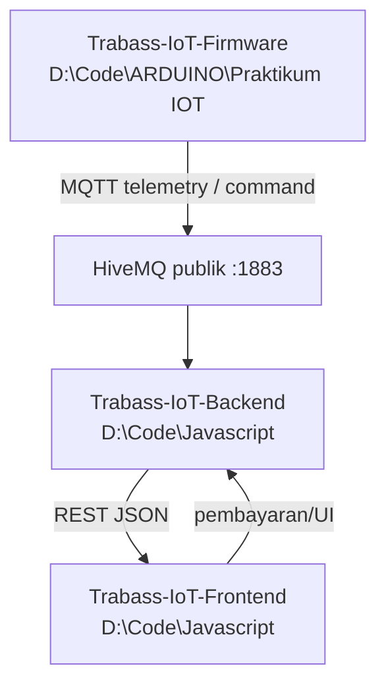

# Struktur Folder & Tanggung Jawab File — Trabass IoT

**Lokasi:** `d:\Code\ARDUINO\Praktikum IOT\Trabass-IoT-Firmware\struktur.md`
**Tanggal:** 2026-11-16 — **diperbarui:** 2026-11-22
**Status:** M1–M7 selesai secara fungsional dengan keterbatasan terdokumentasi. M6A (WiFi + GPRS TinyGSM, broker publik HiveMQ) terimplementasi dan ter-upload; GPRS PASS (`CREG 0,1`, `CIFSR` IP, MQTT/telemetri/command via GPRS). Failover otomatis 30 dtk + pemulihan WiFi terbukti (T37–T40, T42). M5/SMS sudah dihapus. Firmware `1.0.2-gprsfix` ter-upload (auto-probe MPU, I2C 100 kHz, early-drive relay, telemetri `transport`/`link_state`, plus perbaikan state machine GPRS); backend/frontend mengekspos indikator tersebut. M6B T20–T23 lengkap di `bukti/M6B/`. M7 lengkap di `bukti/M7/`: MPU terbaca `0x68` setelah SDA/SCL ditukar, LCD selesai dengan jumper, T25/T27/T41 PASS, T45 **PASS** (GPRS aktif, MQTT via GPRS, telemetri + badge `GPRS` terverifikasi), T04 `PARTIAL`, T26 `DEFERRED`, T46 `PASS`.

Dokumen ini memetakan struktur folder tiga repo yang terlibat integrasi dan menjelaskan peran tiap file. Rencana kerja ada di `perencanaan.md`; konteks teknis ada di `konteks.md`.

---

## 1. Peta tiga repository



| Repo | Root | Peran | Status git |
|---|---|---|---|
| Firmware | `d:\Code\ARDUINO\Praktikum IOT\Trabass-IoT-Firmware` | Perception + actuation, MQTT client | Bukan repo |
| Backend | `d:\Code\Javascript\Trabass-IoT-Backend` | MQTT consumer, REST API, DB/Redis, bisnis | Repo git |
| Frontend | `d:\Code\Javascript\Trabass-IoT-Frontend` | PWA penyewa + dashboard admin | Repo git |

---

## 2. Struktur firmware (fokus utama M2)

```text
Trabass-IoT-Firmware/
├─ perencanaan.md                         # M1–M7, matriks test, DoD  [BARU M1]
├─ konteks.md                             # fakta, wiring, kontrak, batasan [BARU M1]
├─ struktur.md                            # dokumen ini [BARU M1]
├─ baseline/
│  └─ sketch_nov16a_baseline/
│     ├─ sketch_nov16a_baseline.ino       # salinan persis kode tes existing [BARU M1]
│     └─ README.md                        # SHA-256 + aturan restore [BARU M1]
└─ sketch_nov16a/                         # folder sketch yang dibuka Arduino IDE
   ├─ sketch_nov16a.ino                   # orkestrasi setup()/loop() + menu serial [M6A]
   ├─ config.example.h                    # template default: pin, WiFi, GPRS/APN, broker/topik [M6A]
   ├─ config.h                            # override lokal user (WiFi + broker URL) [M6A]
   ├─ app_types.h                         # enum LinkState (+ GPRS) + struct LinkStats [M6A]
   ├─ gps_sensor.h / .cpp                 # parsing NMEA non-blocking [SELESAI M3]
   ├─ imu_sensor.h / .cpp                 # sampling + klasifikasi mpu_motion [SELESAI M3]
   ├─ battery_sensor.h / .cpp             # stub, ENABLE_BATTERY_SENSOR [SELESAI M3]
   ├─ outputs.h / .cpp                    # relay, buzzer, LCD [SELESAI M4]
   ├─ gprs_link.h / .cpp                  # pemilik UART2, TinyGSM SIM800L, attach GPRS, AT/swap/scan [BARU M6A]
   ├─ mqtt_link.h / .cpp                  # WiFi utama + GPRS cadangan, dual PubSubClient, failover, antrean command [M6A]
   ├─ command_handler.h / .cpp            # parse JSON, validasi, dispatch, dedupe; SEND_SMS diabaikan [M6A]
   ├─ telemetry.h / .cpp                  # builder + publish periodik [SELESAI M3]
   └─ self_test.h / .cpp                  # menu tes baseline (tanpa SIM/SMS; GPRS ada di menu 6/9/0) [M6A]
```

> Arduino IDE membuka **`sketch_nov16a/`**. Semua file `.h`/`.cpp` di folder tersebut otomatis ikut terkompilasi. Folder `baseline/` sengaja diletakkan di luar sketch agar tidak dobel kompilasi.

### 2.1 Tanggung jawab file firmware

| File | Tanggung jawab | Milestone |
|---|---|---|
| `sketch_nov16a.ino` | Hanya `setup()`/`loop()` orchestration; tanpa logika sensor; menu `6`/`9`/`0` untuk GPRS | M2–M6A |
| `config.example.h` | Default: pin UART, baud, WiFi, GPRS/APN, failover, broker/topik `trabass/…`, feature flag | M1–M6A |
| `config.h` | Nilai lokal (SSID/password, broker override); include template paling akhir | M1–M6A |
| `app_types.h` | `LinkState` (+ `GprsAttaching`/`GprsConnected`/`MqttGprsConnected`) + `LinkStats` (+ counter GPRS); tipe bersama tanpa definisi variabel | M2–M6A |
| `gps_sensor.*` | `begin()`, `update()`, `hasFix()`, `getLat()/getLng()/getSpeed()/getSats()`, freshness `GPS_FIX_MAX_AGE_MS` | M3 |
| `imu_sensor.*` | `begin()`, `update()`, `motion()`, `readSample()`, retry | M3 |
| `battery_sensor.*` | `begin()`, `read(percent)`; saat ini selalu `false` (`ENABLE_BATTERY_SENSOR 0`) | M3 (stub) |
| `outputs.*` | `setLock()`, `alarmOn()/alarmOff()`, `warningBeep()`, `showMessage()`, `loop()` — non-blocking, pemilik tunggal pin relay/buzzer/LCD | M4 |
| `gprs_link.*` | `begin()`, `loop()`, `attached()`, `requestConnect()`, `release()`, `client()`, `debugAt()`, `swapPins()`, `scanUart()`, `stateLabel()`; pemilik tunggal UART2/TinyGSM | BARU M6A |
| `mqtt_link.*` | `begin()`, `loop()`, `publishTelemetry()`, `takeConnectEvent()`, `takeCommand()`, state/transport/IP GPRS, `stats()`; dua `PubSubClient` + failover WiFi↔GPRS | M2–M6A |
| `command_handler.*` | `begin()`, `loop()`, parse JSON, dedupe `action\|timestamp`, dispatch ke outputs, publish telemetri; `SEND_SMS` → log diabaikan | M4–M6A |
| `telemetry.*` | Susun payload, kirim tiap interval, publish on reconnect lewat transport aktif | M3–M6A |
| `self_test.*` | `i2cScan`, `tesLCD`, `tesBuzzer`, `tesMPU`, `tesGPS`, `tesSemua()` (tanpa SIM/SMS) | M2–M6A |

### 2.2 Aturan modul firmware

1. **SRP:** satu file = satu tanggung jawab. `outputs` tidak boleh membaca sensor; `gps_sensor` tidak boleh menyentuh MQTT.
2. **Non-blocking:** tidak ada `delay()` di `loop()` mode integrasi. Gunakan `millis()`.
3. **Flag:** `setup()` tidak menjalankan `tesSemua()` otomatis; menu tes hanya aktif jika `ENABLE_SERIAL_TEST_MENU 1`.
4. **Error handling:** tiap modul log dengan prefix `[GPS]`, `[IMU]`, `[MQTT]`, `[GPRS]`, `[SIM]`, `[NET]`, `[CMD]`; kegagalan → return false/state aman, bukan reboot.
5. **State awal:** relay OFF dan buzzer LOW saat boot (fail-safe terkunci).
6. **Konfigurasi:** tidak ada angka "ajaib" di `.cpp`; semua di `config.h`.
7. **Callback MQTT:** hanya copy payload ke buffer/antrean; eksekusi di `loop()`.

### 2.3 Manajemen konfigurasi

| File | Isi | Boleh dibagikan? |
|---|---|---|
| `config.example.h` | Default + penjelasan | Ya |
| `config.h` | SSID/password, broker override, override APN/pin bila perlu | **Tidak** |

Jika folder firmware someday dijadikan git repo, tambahkan `.gitignore`:

```gitignore
sketch_nov16a/config.h
*.tmp
```

---

## 3. Struktur backend (referensi integrasi)

```text
Trabass-IoT-Backend/
├─ schema.sql                              # schema DB utama
├─ migration_*.sql                         # migrasi bertahap
├─ mosquitto.conf                          # broker lokal :1883 + WS :9001
├─ .env / .env.example                     # kredensial & konfigurasi
├─ package.json                            # scripts: start, dev, seed:admin
└─ src/
   ├─ app.js                               # Express, mount /api, /health, MQTT listener
   ├─ config/
   │  ├─ db.js                             # mysql2 pool
   │  ├─ redis.js                          # redis client
   │  ├─ mqtt.js                           # MQTT client (HiveMQ) + subscribe trabass/+/telemetry
   │  ├─ station.js                        # geofence, cooldown tamper, threshold baterai
   │  └─ pricing.js                        # tarif sewa & perpanjangan
   ├─ controllers/
   │  ├─ telemetryController.js            # ★ patch no-GPS-fix (M3)
   │  ├─ paymentController.js              # Midtrans, publish UNLOCK/EXTEND/LOCK
   │  ├─ adminController.js                # dashboard bikes, detail, telemetry, settings
   │  ├─ authController.js                 # login admin + quick register penyewa
   │  ├─ bikeController.js                 # data sepeda
   │  ├─ commandController.js              # endpoint kirim command admin
   │  ├─ incidentController.js             # insiden
   │  └─ settingsController.js             # pengaturan runtime
   ├─ services/
   │  ├─ timerService.js                   # warning beep, lock & alarm saat sewa habis
   │  ├─ bikeCommandService.js             # mapping action admin → MQTT
   │  ├─ geofenceService.js                # haversine + cek radius
   │  ├─ incidentService.js                # TAMPER/GEOFENCE/OVERDUE
   │  ├─ notificationService.js            # WA Fonnte (gagal → log-only, tanpa SMS)
   │  └─ settingsService.js                # mutable settings
   ├─ middlewares/                         # auth JWT + role admin
   └─ routes/api.js                        # daftar endpoint /api
```

### 3.1 File backend yang akan disentuh

| File | Perubahan | Milestone | Alasan |
|---|---|---|---|
| `src/controllers/telemetryController.js` | Terima telemetri tanpa `lat/lng`, update Redis + tamper, skip log/geofence | M3 | Demo indoor tetap termonitor |
| `src/services/timerService.js` | Guard `hSet` tanpa koordinat | M3 | Hindari `has_live_location` palsu |
| `src/controllers/paymentController.js` | Guard cache serupa | M3 | Konsistensi |
| `.env` | `STATION_LAT=-7.7626945`, `STATION_LNG=110.4095241`, `GEOFENCE_RADIUS_M=5000`, `MQTT_BROKER_URL=mqtt://broker.hivemq.com:1883` | M4 + M6A | Pangkalan Kampus 1 radius 5 km; broker publik agar GPRS bisa reach |
| `src/config/mqtt.js` | Subscribe `trabass/+/telemetry`; opsional `bike/ack/+` | M6A + M7 | Topik namespaced broker publik; ACK menyusul |
| `src/app.js` | Filter `topic.startsWith('trabass/') && endsWith('/telemetry')` | M6A | Hanya telemetri namespace sendiri yang diproses |
| `src/controllers/telemetryController.js` | Parse `trabass/<id>/telemetry` (toleran format lama), publish command ke `trabass/<id>/command` | M6A | Kontrak topik baru |
| `src/controllers/paymentController.js`, `src/services/timerService.js`, `src/services/bikeCommandService.js` | Publish command ke `trabass/<id>/command` | M6A | Semua jalur command konsisten |
| `src/services/notificationService.js` | Hapus publish `SEND_SMS`; WA gagal → log-only | M6A | Firmware GPRS-only, SMS retired |

> File backend lain **tidak diubah** tanpa justifikasi teknis dan persetujuan user. `adminController.js` tetap utuh.

**Status patch M3:** ketiga file sudah diterapkan dan diuji (`node --check` exit 0). Detail perilaku ada di `konteks.md` bagian 6 dan hasil uji di `perencanaan.md`.

**Status M4:** modul `outputs.*` dan `command_handler.*` dibuat; `mqtt_link.cpp`, `.ino`, `self_test.cpp`, dan `config.example.h` disesuaikan. Backend hanya `.env` yang diubah. Firmware produksi `1.0.0-m4` sudah di-upload ulang dengan `ALARM_DURATION_MS=60000`. Build override `ALARM_DURATION_MS=3000` dipakai untuk uji alarm lalu diganti. Frontend tidak diubah.

**Status M5 (arsip):** modul `sms_service.*` pernah dibuat dan di-upload (`1.0.0-m5`, flash 954.280 B, RAM 52.464 B). Antrean/sanitasi/retry/regresi terbukti (T33–T36), tetapi **T19 `BLOCKED`**. **Disupersede M6A**: file SMS dihapus, T19/T31–T36 `RETIRED`.

**Status M6A:** modul `gprs_link.*` baru; `mqtt_link.*` ditulis ulang untuk dua `PubSubClient` + failover; `.ino`, `command_handler.cpp`, `self_test.*`, `app_types.h`, `config.example.h`, `config.h` disesuaikan. Backend: `.env`, `src/config/mqtt.js`, `src/app.js`, `telemetryController.js`, `paymentController.js`, `timerService.js`, `bikeCommandService.js`, `notificationService.js`. Frontend tidak diubah. Data: tabel `app_settings` di-update ke pangkalan/radius final (kode tidak diubah). Firmware `1.0.0-gprs` ter-upload COM14: flash 966.008 B (73%), RAM 52.400 B (15%). Telemetri/command via WiFi + topik baru PASS. Pin final: SIM 16/17 (VDD 3V3), GPS 26/27; baud modem dikunci 9600; adaptor 5 V/3 A terpasang. Radio WiFi dimatikan saat GPRS dicoba. GPRS PASS (T37): `CSQ 13–19`, `CREG 0,1`, `COPS "TELKOMSEL"`, `CGATT 1`, `CIFSR 10.x.x.x`; MQTT connected via GPRS; telemetri masuk `telemetry_logs` id 2286–2295; command `UNLOCK`/`LOCK` via GPRS dieksekusi. Failover otomatis 30 dtk + `Transport -> WIFI (WiFi pulih stabil)` PASS (T40). T41 PARTIAL; T42 PASS. Tidak ada commit/push.

**Pra-M6B (hardening):** diagnostik `hwdiag_stage0_filtered.log` menunjukkan I2C hanya `0x27`, MPU6050 tidak terdeteksi (`0x68`/`0x69` tidak ada), LCD merespons, relay `LOCKED pin=1`. Firmware `1.0.1-hwdiag` ditambah auto-probe MPU, `Wire.setClock(100000)`, early-drive relay `RELAY_OFF` sebelum `pinMode(OUTPUT)`, dan field `transport`/`link_state` pada telemetri. Compile sukses (966.308 B, 52.400 B RAM) dan upload COM14 sukses (verified hash). `hwdiag_post_hardening_clean.log` membuktikan payload `transport:"WIFI"`, `link_state:"MQTT_CONNECTED"`, `fw_version:"1.0.1-hwdiag"`, MPU tetap `GAGAL`, relay `LOCKED pin=1`. Backend `telemetryController.js` menyimpan field ke Redis; `adminController.js` mengeksposnya; setelah restart nodemon, `GET /api/admin/bikes/BK-001` mengembalikan `transport=WIFI link_state=MQTT_CONNECTED` dan list `/api/admin/bikes` juga. Frontend `AdminBikeDetail.jsx` menambah badge transport/status `Reconnecting`; `.env` geofence disamakan ke pangkalan/radius final; `npm run build` sukses. `tabel_pin.md` dan `perencanaan.md` (T43–T46) diperbarui. Catatan arsip: saat itu perbaikan fisik MPU/VCC LCD dan failover GPRS sungguhan masih menunggu user; keduanya kemudian terselesaikan di M7 (lihat bagian Status M7).

**Status M7 (selesai fungsional dengan keterbatasan):** bukti di `bukti/M7/`. T25 `PASS` (restart backend, Redis/DB/MQTT pulih, data konsisten). T27 `PASS` (reboot saat sewa aktif: `POWERON_RESET` → `Relay=OFF`, telemetri `lock_state=true`, rental 60 cleanup `COMPLETED`). T41 `PASS (kumulatif)`: 364 telemetri / 29,67 menit dari 8 segmen, 0 publish gagal, uptime monotone ~65 menit tanpa reboot; bukan satu sesi 30 menit tanpa jeda. T43 `PARTIAL`: MPU terbaca di `0x68` setelah SDA/SCL ditukar, tetapi `mpu_motion` produksi belum terpicu goyangan fisik. T44 `PASS (dilaporkan user)`: LCD selesai dengan jumper, `0x27` terverifikasi. Stale UI terbukti (`T45_stale_api.json` age 65,4 dtk + `T45_stale_bike.png`). Arsip kegagalan awal ada di `T45_failover_note.txt`; **T45 PASS** setelah diagnosis SIM800L dan patch `1.0.2-gprsfix` — bukti `T45_GPRS_success_note.txt`, `GPRS_after_fw_patch_20261122.log` (`[GPRS] AKTIF IP=10.198.189.40`, `MQTT Connected via GPRS`, telemetri `transport:"GPRS"`, `publish=22 gagal=0`), `T45_admin_api_GPRS.json`, `T45_dashboard_GPRS_full.png` (`Live` + `GPRS`). Isi `config.h` tetap SSID asli; perubahan hash hanya normalisasi LF/CRLF dan file ini di-gitignore. T04 `PARTIAL`, T26 `DEFERRED`, T46 `PASS` (user mengonfirmasi tidak ada klik/tegasi relay saat reset fisik). M7 dinyatakan selesai secara fungsional dengan catatan keterbatasan ini.

**Status M6B:** T20–T23 dijalankan dengan empat jenis bukti di `bukti/M6B/`. T20 memakai order sintetik dan simulasi webhook lokal dengan signature SHA512; HTTP 200, rental id 59 `SETTLED/ACTIVE`, backend `[MQTT PUB] ... UNLOCK`, Serial `Relay=ON pin=LOW -> TERBUKA`, telemetri `lock_state:false`. Ini **bukan** settlement Midtrans sungguhan. T21 memakai `UPDATE rentals.end_time` menjadi 20 detik; warning + expiry terbukti, insiden OVERDUE id 12, command `LOCK_AND_ALARM`, relay OFF, alarm ON. T22/T23 menyuntik telemetri ke `trabass/BK-001/telemetry`: geofence 6090 m memicu insiden id 18–20 + `ALARM_ON` + WA nyata; `mpu_motion=true` memicu insiden TAMPER id 22 + `ALARM_ON` + WA nyata, lalu ditutup dengan `lock_state=false`. Semua screenshot dashboard tersimpan (`t20_admin_bike.png`, `t21_admin_fleet.png`, `t21_admin_incidents.png`, `t22_admin_map.png`, `t22_admin_incidents.png`, `t23_admin_fleet.png`, `t23_admin_incidents.png`, `t23_admin_bike.png`). Cleanup memakai endpoint admin `POST /api/admin/bikes/BK-001/end-rental`: rental 59 `COMPLETED`, sepeda `AVAILABLE`, `lock_state=1`, command `LOCK` diterima firmware. Keterbatasan: T22/T23 sintetik, heartbeat device menimpa koordinat uji sehingga insiden geofence ber-flap, buzzer/LCD fisik belum dikonfirmasi, broker publik anonymous tanpa TLS. Tidak ada perubahan kode backend/frontend untuk eksekusi M6B ini, hanya data uji dan artefak bukti.

---

## 4. Struktur frontend (referensi integrasi)

```text
Trabass-IoT-Frontend/
├─ .env                                    # VITE_API_URL=http://localhost:3000/api
├─ vite.config.js                          # dev server Vite
├─ index.html
└─ src/
   ├─ main.jsx / App.jsx
   ├─ services/api.js                      # axios + JWT + endpoint REST
   ├─ utils/fleetTelemetry.js              # normalisasi telemetri, stale 30 s
   ├─ hooks/
   │  ├─ useAdminBikes.js                  # polling daftar armada 5 s
   │  ├─ useAdminBikeDetail.js             # polling detail + riwayat 5 s
   │  └─ useBikeCommands.js                # kirim FORCE_LOCK/UNLOCK/ALARM_OFF
   ├─ components/admin/
   │  ├─ BatteryGauge.jsx                  # tampil N/A bila battery null
   │  ├─ ImuMonitorPanel.jsx               # Gerak/Diam dari mpu_motion
   │  ├─ FleetMap.jsx                      # peta Leaflet
   │  └─ AnomalyAlertBanner.jsx            # alert insiden
   └─ pages/
      ├─ AdminBikes.jsx
      ├─ AdminBikeDetail.jsx
      └─ ... (PWA penyewa, pembayaran)
```

### 4.1 Perubahan frontend

| Milestone | Perubahan |
|---|---|
| M1–M4 | **Tidak ada** |
| M6 | Hanya `.env`: `VITE_API_URL` ke IP LAN jika diakses dari HP; Vite `--host` |
| Opsional | Status `gps_fix` / grafik IMU/baterai → **butuh persetujuan terpisah** |

---

## 5. Konvensi penamaan

| Jenis | Konvensi | Contoh |
|---|---|---|
| File modul firmware | `nama_modul.h` + `nama_modul.cpp` | `gps_sensor.h`, `gps_sensor.cpp` |
| Macro konfigurasi | UPPER_SNAKE + grup | `MQTT_BROKER_HOST`, `IMU_MOTION_HOLD_MS` |
| Fungsi firmware | camelCase | `wifiEnsureConnected()`, `publishTelemetry()` |
| Topik MQTT | `bike/<jenis>/<bike_id>` | `bike/telemetry/BK-001` |
| Test case | `B##` baseline, `T##` integrasi | `B06`, `T23` |
| Log Serial | `[MODUL] pesan` | `[MQTT] Terhubung ke 10.20.226.246` |

---

## 6. Urutan pembuatan file (checklist)

### 6.1 M1 — fondasi

- [x] `perencanaan.md`
- [x] `konteks.md`
- [x] `struktur.md`
- [x] `baseline/sketch_nov16a_baseline/sketch_nov16a_baseline.ino`
- [x] `baseline/sketch_nov16a_baseline/README.md`
- [x] `sketch_nov16a/config.example.h`
- [x] `sketch_nov16a/config.h`
- [x] Instal `TinyGPSPlus v1.0.3a`
- [x] Instal `PubSubClient v2.8`
- [x] Instal `ArduinoJson v7.4.3`
- [x] User isi kredensial WiFi di `config.h`
- [x] User jalankan baseline test `a`, `1`–`7`, `s`

### 6.2 M2 — komunikasi

- [x] `app_types.h` (`LinkState`, `LinkStats`)
- [x] `mqtt_link.h` / `mqtt_link.cpp`
- [x] `self_test.h` / `self_test.cpp`
- [x] Refactor `sketch_nov16a.ino` menjadi orkestrasi + menu serial
- [x] Flag `WIFI_CONNECT_TIMEOUT_MS`, `MQTT_SUBSCRIBE_QOS`, `MQTT_ENABLE_LWT`
- [x] Kompilasi bersih (`arduino-cli`, exit 0)
- [x] Upload ke COM14
- [x] Bukti heartbeat, command reception, boot aman, menu regresi
- [x] Uji reconnect WiFi (T03) dan jalur reconnect broker (T04 PARTIAL)
- [x] Konfirmasi user sebelum masuk M3

### 6.3 M3 — telemetri dan patch no-fix

- [x] `gps_sensor.h` / `.cpp` (non-blocking, freshness fix)
- [x] `imu_sensor.h` / `.cpp` (sampling 100 ms, hold/idle, retry)
- [x] `battery_sensor.h` / `.cpp` (stub)
- [x] `telemetry.h` / `.cpp` (payload fix/no-fix, publish periodik + on connect)
- [x] `mqtt_link` diganti dari heartbeat ke `publishTelemetry()` + `takeConnectEvent()`
- [x] `self_test::tesMPU()` memakai `imu_sensor`
- [x] Menu serial `n` (jaringan+sensor), `m` (publish), `t` (payload)
- [x] `config.example.h`: `GPS_FIX_MAX_AGE_MS`, `TELEMETRY_JSON_BUFFER`, log payload, retry IMU
- [x] Patch backend: `telemetryController.js`, `timerService.js`, `paymentController.js`
- [x] Kompilasi produksi exit 0 (939.744 B/71%, RAM 49.824 B/15%)
- [x] Upload produksi ke COM14, hash verified
- [x] Bukti fix, no-fix, Redis, MySQL, dashboard, TAMPER
- [ ] Keputusan user: koreksi `STATION_LAT/LNG` atau terima status `GEOFENCE_VIOLATION`
- [ ] Konfirmasi user sebelum masuk M4

---

## 7. Catatan penting

- Sejak M2, `sketch_nov16a.ino` **sudah diubah** menjadi orkestrasi; fungsi tes baseline dipindah ke `self_test.*` tanpa mengubah perilakunya.
- Modul M3 (`gps_sensor`, `imu_sensor`, `battery_sensor`, `telemetry`) **sudah dibuat dan diuji**; `outputs.*` serta `command_handler.*` baru dibuat di M4.
- Port COM14 eksklusif: tutup Serial Monitor Arduino IDE sebelum `arduino-cli upload`.
- Jangan memindahkan `baseline/` ke dalam `sketch_nov16a/` karena Arduino IDE akan mengompilasi dua sketch `.ino`.
