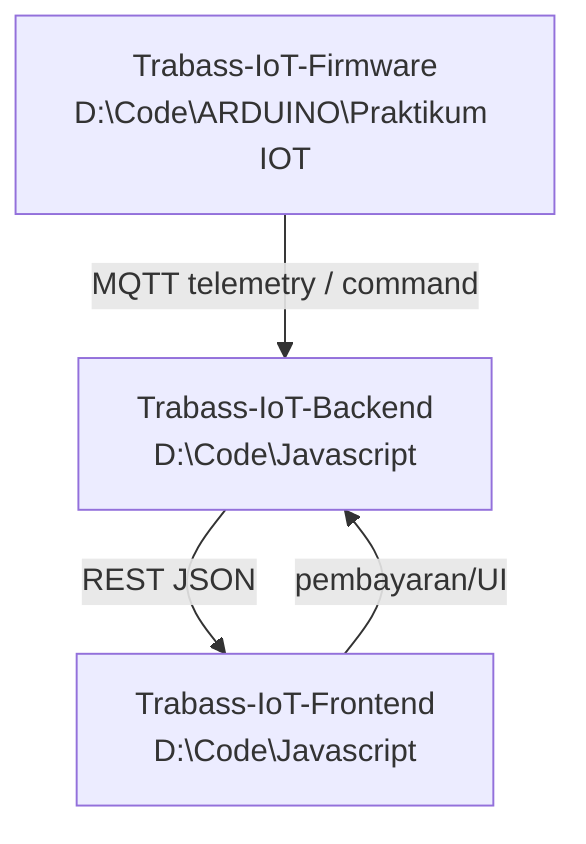

# Struktur Folder & Tanggung Jawab File — Trabass IoT

**Lokasi:** `d:\Code\ARDUINO\Praktikum IOT\Trabass-IoT-Firmware\struktur.md`
**Tanggal:** 2026-11-16
**Status:** M4 (command downlink + aktuator; telemetri dan konektivitas sudah terintegrasi)

Dokumen ini memetakan struktur folder tiga repo yang terlibat integrasi dan menjelaskan peran tiap file. Rencana kerja ada di `perencanaan.md`; konteks teknis ada di `konteks.md`.

---

## 1. Peta tiga repository



| Repo | Root | Peran | Status git |
|---|---|---|---|
| Firmware | `d:\Code\ARDUINO\Praktikum IOT\Trabass-IoT-Firmware` | Perception + actuation, MQTT client | Bukan repo |
| Backend | `d:\Code\Javascript\Trabass-IoT-Backend` | MQTT consumer, REST API, DB/Redis, bisnis | Repo git |
| Frontend | `d:\Code\Javascript\Trabass-IoT-Frontend` | PWA penyewa + dashboard admin | Repo git |

---

## 2. Struktur firmware (fokus utama M2)

```text
Trabass-IoT-Firmware/
├─ perencanaan.md                         # M1–M7, matriks test, DoD  [BARU M1]
├─ konteks.md                             # fakta, wiring, kontrak, batasan [BARU M1]
├─ struktur.md                            # dokumen ini [BARU M1]
├─ baseline/
│  └─ sketch_nov16a_baseline/
│     ├─ sketch_nov16a_baseline.ino       # salinan persis kode tes existing [BARU M1]
│     └─ README.md                        # SHA-256 + aturan restore [BARU M1]
└─ sketch_nov16a/                         # folder sketch yang dibuka Arduino IDE
   ├─ sketch_nov16a.ino                   # orkestrasi setup()/loop() + menu serial [SELESAI M3]
   ├─ config.example.h                    # template default semua konfigurasi [SELESAI M1]
   ├─ config.h                            # override lokal user [SELESAI M1]
   ├─ app_types.h                         # enum LinkState + struct LinkStats [SELESAI M2]
   ├─ gps_sensor.h / .cpp                 # parsing NMEA non-blocking [SELESAI M3]
   ├─ imu_sensor.h / .cpp                 # sampling + klasifikasi mpu_motion [SELESAI M3]
   ├─ battery_sensor.h / .cpp             # stub, ENABLE_BATTERY_SENSOR [SELESAI M3]
   ├─ outputs.h / .cpp                    # relay, buzzer, LCD [SELESAI M4]
   ├─ mqtt_link.h / .cpp                  # WiFi, MQTT, reconnect, publish telemetri, antrean command [SELESAI M4]
   ├─ command_handler.h / .cpp            # parse JSON, validasi, dispatch, dedupe [SELESAI M4]
   ├─ sms_service.h / .cpp                # antrean AT command SIM800L [M5]
   ├─ telemetry.h / .cpp                  # builder + publish periodik [SELESAI M3]
   └─ self_test.h / .cpp                  # menu tes baseline dipindah ke sini [SELESAI M2]
```

> Arduino IDE membuka **`sketch_nov16a/`**. Semua file `.h`/`.cpp` di folder tersebut otomatis ikut terkompilasi. Folder `baseline/` sengaja diletakkan di luar sketch agar tidak dobel kompilasi.

### 2.1 Tanggung jawab file firmware

| File | Tanggung jawab | Milestone |
|---|---|---|
| `sketch_nov16a.ino` | Hanya `setup()`/`loop()` orchestration; tanpa logika sensor | M2–M4 |
| `config.example.h` | Semua default: pin, baud, WiFi placeholder, MQTT, threshold, feature flag | M1 |
| `config.h` | Nilai lokal (kredensial, IP, override); include template paling akhir | M1 |
| `app_types.h` | `LinkState` (Offline/WifiConnecting/WifiConnected/MqttConnected) + `LinkStats`; tipe bersama tanpa definisi variabel | M2 |
| `gps_sensor.*` | `begin()`, `update()`, `hasFix()`, `getLat()/getLng()/getSpeed()/getSats()`, freshness `GPS_FIX_MAX_AGE_MS` | M3 |
| `imu_sensor.*` | `begin()`, `update()`, `motion()`, `readSample()`, retry | M3 |
| `battery_sensor.*` | `begin()`, `read(percent)`; saat ini selalu `false` (`ENABLE_BATTERY_SENSOR 0`) | M3 (stub) |
| `outputs.*` | `setLock()`, `alarmOn()/alarmOff()`, `warningBeep()`, `showMessage()`, `loop()` — non-blocking, pemilik tunggal pin relay/buzzer/LCD | M4 |
| `mqtt_link.*` | `begin()`, `loop()`, `publishTelemetry()`, `takeConnectEvent()`, `takeCommand()`, `stateLabel()`, `stats()`; loop tidak lagi menguras antrean command | M2–M4 |
| `command_handler.*` | `begin()`, `loop()`, parse JSON, dedupe `action\|timestamp`, dispatch ke outputs, publish telemetri | M4 |
| `sms_service.*` | `queueSms()`, `smsLoop()` state machine AT | M5 |
| `telemetry.*` | Susun payload, kirim tiap interval, publish on reconnect | M3 |
| `self_test.*` | Pindahkan `i2cScan`, `tesLCD`, `tesBuzzer`, `tesMPU`, `tesGPS`, `tesSIM`, `kirimSMS` | M2 |

### 2.2 Aturan modul firmware

1. **SRP:** satu file = satu tanggung jawab. `outputs` tidak boleh membaca sensor; `gps_sensor` tidak boleh menyentuh MQTT.
2. **Non-blocking:** tidak ada `delay()` di `loop()` mode integrasi. Gunakan `millis()`.
3. **Flag:** `setup()` tidak menjalankan `tesSemua()` otomatis; menu tes hanya aktif jika `ENABLE_SERIAL_TEST_MENU 1`.
4. **Error handling:** tiap modul log dengan prefix `[GPS]`, `[IMU]`, `[MQTT]`, `[SMS]`, `[CMD]`; kegagalan → return false/state aman, bukan reboot.
5. **State awal:** relay OFF dan buzzer LOW saat boot (fail-safe terkunci).
6. **Konfigurasi:** tidak ada angka "ajaib" di `.cpp`; semua di `config.h`.
7. **Callback MQTT:** hanya copy payload ke buffer/antrean; eksekusi di `loop()`.

### 2.3 Manajemen konfigurasi

| File | Isi | Boleh dibagikan? |
|---|---|---|
| `config.example.h` | Default + penjelasan | Ya |
| `config.h` | SSID/password, IP override, nomor SMS | **Tidak** |

Jika folder firmware someday dijadikan git repo, tambahkan `.gitignore`:

```gitignore
sketch_nov16a/config.h
*.tmp
```

---

## 3. Struktur backend (referensi integrasi)

```text
Trabass-IoT-Backend/
├─ schema.sql                              # schema DB utama
├─ migration_*.sql                         # migrasi bertahap
├─ mosquitto.conf                          # broker lokal :1883 + WS :9001
├─ .env / .env.example                     # kredensial & konfigurasi
├─ package.json                            # scripts: start, dev, seed:admin
└─ src/
   ├─ app.js                               # Express, mount /api, /health, MQTT listener
   ├─ config/
   │  ├─ db.js                             # mysql2 pool
   │  ├─ redis.js                          # redis client
   │  ├─ mqtt.js                           # MQTT client + subscribe bike/telemetry/+
   │  ├─ station.js                        # geofence, cooldown tamper, threshold baterai
   │  └─ pricing.js                        # tarif sewa & perpanjangan
   ├─ controllers/
   │  ├─ telemetryController.js            # ★ patch no-GPS-fix (M3)
   │  ├─ paymentController.js              # Midtrans, publish UNLOCK/EXTEND/LOCK
   │  ├─ adminController.js                # dashboard bikes, detail, telemetry, settings
   │  ├─ authController.js                 # login admin + quick register penyewa
   │  ├─ bikeController.js                 # data sepeda
   │  ├─ commandController.js              # endpoint kirim command admin
   │  ├─ incidentController.js             # insiden
   │  └─ settingsController.js             # pengaturan runtime
   ├─ services/
   │  ├─ timerService.js                   # warning beep, lock & alarm saat sewa habis
   │  ├─ bikeCommandService.js             # mapping action admin → MQTT
   │  ├─ geofenceService.js                # haversine + cek radius
   │  ├─ incidentService.js                # TAMPER/GEOFENCE/OVERDUE
   │  ├─ notificationService.js            # WA Fonnte + fallback SMS MQTT
   │  └─ settingsService.js                # mutable settings
   ├─ middlewares/                         # auth JWT + role admin
   └─ routes/api.js                        # daftar endpoint /api
```

### 3.1 File backend yang akan disentuh

| File | Perubahan | Milestone | Alasan |
|---|---|---|---|
| `src/controllers/telemetryController.js` | Terima telemetri tanpa `lat/lng`, update Redis + tamper, skip log/geofence | M3 | Demo indoor tetap termonitor |
| `src/services/timerService.js` | Guard `hSet` tanpa koordinat | M3 | Hindari `has_live_location` palsu |
| `src/controllers/paymentController.js` | Guard cache serupa | M3 | Konsistensi |
| `.env` | `STATION_LAT=-7.7626945`, `STATION_LNG=110.4095241`, `GEOFENCE_RADIUS_M=5000` | M4 (prasyarat) | Pangkalan diubah ke Kampus 1 UPN Veteran Yogyakarta; radius aman 5 km |
| `src/config/mqtt.js` | Opsional subscribe `bike/ack/+` | M7 (opsional) | Bukti eksekusi command |

> File backend lain **tidak diubah** tanpa justifikasi teknis dan persetujuan user. `adminController.js` tetap utuh.

**Status patch M3:** ketiga file sudah diterapkan dan diuji (`node --check` exit 0). Detail perilaku ada di `konteks.md` bagian 6 dan hasil uji di `perencanaan.md`.

**Status M4:** modul `outputs.*` dan `command_handler.*` dibuat; `mqtt_link.cpp`, `.ino`, `self_test.cpp`, dan `config.example.h` disesuaikan. Backend hanya `.env` yang diubah. Firmware produksi `1.0.0-m4` sudah di-upload ulang dengan `ALARM_DURATION_MS=60000`. Build override `ALARM_DURATION_MS=3000` dipakai untuk uji alarm lalu diganti. Frontend tidak diubah.

---

## 4. Struktur frontend (referensi integrasi)

```text
Trabass-IoT-Frontend/
├─ .env                                    # VITE_API_URL=http://localhost:3000/api
├─ vite.config.js                          # dev server Vite
├─ index.html
└─ src/
   ├─ main.jsx / App.jsx
   ├─ services/api.js                      # axios + JWT + endpoint REST
   ├─ utils/fleetTelemetry.js              # normalisasi telemetri, stale 30 s
   ├─ hooks/
   │  ├─ useAdminBikes.js                  # polling daftar armada 5 s
   │  ├─ useAdminBikeDetail.js             # polling detail + riwayat 5 s
   │  └─ useBikeCommands.js                # kirim FORCE_LOCK/UNLOCK/ALARM_OFF
   ├─ components/admin/
   │  ├─ BatteryGauge.jsx                  # tampil N/A bila battery null
   │  ├─ ImuMonitorPanel.jsx               # Gerak/Diam dari mpu_motion
   │  ├─ FleetMap.jsx                      # peta Leaflet
   │  └─ AnomalyAlertBanner.jsx            # alert insiden
   └─ pages/
      ├─ AdminBikes.jsx
      ├─ AdminBikeDetail.jsx
      └─ ... (PWA penyewa, pembayaran)
```

### 4.1 Perubahan frontend

| Milestone | Perubahan |
|---|---|
| M1–M4 | **Tidak ada** |
| M6 | Hanya `.env`: `VITE_API_URL` ke IP LAN jika diakses dari HP; Vite `--host` |
| Opsional | Status `gps_fix` / grafik IMU/baterai → **butuh persetujuan terpisah** |

---

## 5. Konvensi penamaan

| Jenis | Konvensi | Contoh |
|---|---|---|
| File modul firmware | `nama_modul.h` + `nama_modul.cpp` | `gps_sensor.h`, `gps_sensor.cpp` |
| Macro konfigurasi | UPPER_SNAKE + grup | `MQTT_BROKER_HOST`, `IMU_MOTION_HOLD_MS` |
| Fungsi firmware | camelCase | `wifiEnsureConnected()`, `publishTelemetry()` |
| Topik MQTT | `bike/<jenis>/<bike_id>` | `bike/telemetry/BK-001` |
| Test case | `B##` baseline, `T##` integrasi | `B06`, `T23` |
| Log Serial | `[MODUL] pesan` | `[MQTT] Terhubung ke 10.20.226.246` |

---

## 6. Urutan pembuatan file (checklist)

### 6.1 M1 — fondasi

- [x] `perencanaan.md`
- [x] `konteks.md`
- [x] `struktur.md`
- [x] `baseline/sketch_nov16a_baseline/sketch_nov16a_baseline.ino`
- [x] `baseline/sketch_nov16a_baseline/README.md`
- [x] `sketch_nov16a/config.example.h`
- [x] `sketch_nov16a/config.h`
- [x] Instal `TinyGPSPlus v1.0.3a`
- [x] Instal `PubSubClient v2.8`
- [x] Instal `ArduinoJson v7.4.3`
- [x] User isi kredensial WiFi di `config.h`
- [x] User jalankan baseline test `a`, `1`–`7`, `s`

### 6.2 M2 — komunikasi

- [x] `app_types.h` (`LinkState`, `LinkStats`)
- [x] `mqtt_link.h` / `mqtt_link.cpp`
- [x] `self_test.h` / `self_test.cpp`
- [x] Refactor `sketch_nov16a.ino` menjadi orkestrasi + menu serial
- [x] Flag `WIFI_CONNECT_TIMEOUT_MS`, `MQTT_SUBSCRIBE_QOS`, `MQTT_ENABLE_LWT`
- [x] Kompilasi bersih (`arduino-cli`, exit 0)
- [x] Upload ke COM14
- [x] Bukti heartbeat, command reception, boot aman, menu regresi
- [x] Uji reconnect WiFi (T03) dan jalur reconnect broker (T04 PARTIAL)
- [x] Konfirmasi user sebelum masuk M3

### 6.3 M3 — telemetri dan patch no-fix

- [x] `gps_sensor.h` / `.cpp` (non-blocking, freshness fix)
- [x] `imu_sensor.h` / `.cpp` (sampling 100 ms, hold/idle, retry)
- [x] `battery_sensor.h` / `.cpp` (stub)
- [x] `telemetry.h` / `.cpp` (payload fix/no-fix, publish periodik + on connect)
- [x] `mqtt_link` diganti dari heartbeat ke `publishTelemetry()` + `takeConnectEvent()`
- [x] `self_test::tesMPU()` memakai `imu_sensor`
- [x] Menu serial `n` (jaringan+sensor), `m` (publish), `t` (payload)
- [x] `config.example.h`: `GPS_FIX_MAX_AGE_MS`, `TELEMETRY_JSON_BUFFER`, log payload, retry IMU
- [x] Patch backend: `telemetryController.js`, `timerService.js`, `paymentController.js`
- [x] Kompilasi produksi exit 0 (939.744 B/71%, RAM 49.824 B/15%)
- [x] Upload produksi ke COM14, hash verified
- [x] Bukti fix, no-fix, Redis, MySQL, dashboard, TAMPER
- [ ] Keputusan user: koreksi `STATION_LAT/LNG` atau terima status `GEOFENCE_VIOLATION`
- [ ] Konfirmasi user sebelum masuk M4

---

## 7. Catatan penting

- Sejak M2, `sketch_nov16a.ino` **sudah diubah** menjadi orkestrasi; fungsi tes baseline dipindah ke `self_test.*` tanpa mengubah perilakunya.
- Modul M3 (`gps_sensor`, `imu_sensor`, `battery_sensor`, `telemetry`) **sudah dibuat dan diuji**; `outputs.*` serta `command_handler.*` baru dibuat di M4.
- Port COM14 eksklusif: tutup Serial Monitor Arduino IDE sebelum `arduino-cli upload`.
- Jangan memindahkan `baseline/` ke dalam `sketch_nov16a/` karena Arduino IDE akan mengompilasi dua sketch `.ino`.
